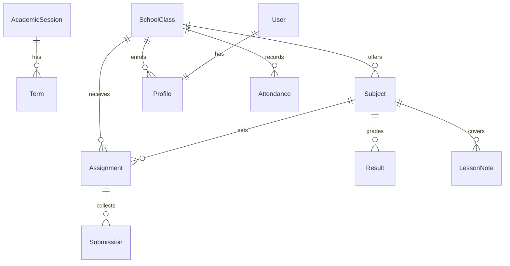

# Academic Dashboard — Nigerian School Management System

A class-centric school management platform for Nigerian primary and secondary schools, built as a
Django REST API plus an installable Angular SPA. One teacher manages one class of 10–50 students:
they set work, enter and publish results, write weekly lesson notes, post announcements and take the
daily register — and they decide exactly what students are allowed to see.

It was designed around how these schools actually work: end-of-term report cards with a position in
class, a broadsheet for the whole class, results keyed in from a spreadsheet, and unreliable internet.


## Core features

**Nigerian school specifics**

- **Term and session management** — `2025/2026` sessions with First, Second and Third Term; one of
  each is "current" and every result, note, assignment and report is scoped to a session and term.
- **Results on the WAEC scale** — CA1 (10) + CA2 (10) + CA3 (20) + Exam (60), totals out of 100, and
  A–F grades with remarks computed on save.
- **Broadsheet analytics** — `GET /api/classes/{id}/broadsheet/` returns the whole class as a grid:
  each student's total per subject, their average, their position (ties share a position: 1, 2, 2, 4),
  and each subject's class average. Only published results count, so the sheet matches what parents see.
- **CSV bulk import** — download the `Admission Number, Subject, CA1, CA2, CA3, Exam` template, fill it
  in offline, upload it back. Rows are validated (known admission number, subject in the class, score
  caps) and the response reports every created, updated and rejected row with a reason; new rows stay
  drafts until a teacher publishes them.
- **Print-ready report cards** — a single HTML page with A4 print CSS: student details, cognitive
  table with per-subject class averages, overall total and average, **position in class**
  ("12th out of 13 students"), affective and psychomotor domains, class teacher's and principal's
  remarks, next term fees and resumption date. Students print their own; the browser's "Save as PDF"
  does the rest, so no server-side PDF toolchain is needed.
- **Automated parent alerts** — an absence, a successful fee payment or a published result reaches
  the parent's phone by SMS or WhatsApp without a teacher writing a message. Delivery is logged and
  the school administrator can see the delivery rate.
- **Offline-first** — the SPA is an installable PWA. The app shell, icons and fonts are cached, and
  previously loaded results, notes and assignments remain readable when the connection drops.

**For parents and the school office**

- **Parent portal** — one account follows all of a family's children: a card per ward with their
  current-term average and 30-day attendance, read-only term report cards (same printable document as
  the student portal), and a fees page with every bill, part payment and balance.
- **School fees with Paystack** — the office bills each class level per term; a parent taps **Pay now**
  and is handed to Paystack's secure checkout. The signed webhook credits the fee automatically, so
  balances and payment history update without anyone touching the admin.

**Both portals**

- Student portal: published results by term, report card printing, lesson notes with attachments,
  assignments and uploads, the daily register and school notices.
- Teacher portal: class roster with CSV student onboarding, score entry with publish/archive,
  broadsheet with template download and CSV upload, lesson notes with attachments, assignment
  marking, submissions grading, announcements (create, edit, publish) and the register.
- Low-bandwidth budget: the production build ships 318 kB raw initial JavaScript (≈88 kB over
  the wire) with lazy-loaded route groups and gzip on at the web server. The raw Angular budget is
  400/500 kB for feature headroom; gzipped transfer under ~120 kB remains the real constraint.

## The publishing rule

Every piece of content a teacher creates — `Result`, `LessonNote`, `Assignment`, `Announcement` — has a
status: **draft**, **published** or **archived**.

- A teacher sees everything they own, drafts included.
- A student only ever receives rows with `status = published` that belong to **their own class**.
- School-wide announcements (no class) reach every student, once published.
- Publishing is explicit: `PATCH` with `{"status": "published"}` or `POST /api/<resource>/{id}/publish/`.
  `published_at` is stamped automatically.

The filter is applied in the queryset, not the client, so a draft result cannot leak through a list
endpoint, a detail endpoint, a broadsheet, a report card or a search parameter.

## Domain model



- **School** — the school's identity (name, motto, address, phone, email, logo) and its current session
  and term. One row today; the unique `slug` leaves room for multi-tenancy later.
- **AcademicSession / Term** — e.g. `2025/2026`, `First Term`. One of each is current; the API exposes
  `GET /api/terms/current/`.
- **SchoolClass** — e.g. `JSS 2A`, with a class teacher and a capacity between 10 and 50.
- **Subject** — belongs to a class and is taught by a teacher.
- **Result** — `CA1` (10) + `CA2` (10) + `CA3` (20) + `Exam` (60) = `Total` (/100). Grade and remark are
  derived on save, and an optional `teacher_remark` provides the report-card comment.
- **LessonNote** — week number, topic, content and an optional attachment, per subject and term.
- **Announcement** — whole-school or one class.
- **Assignment / Submission / Attendance** — class work, uploads and the daily register.

### Grading (WAEC-style)

| Total | Grade | Remark |
| --- | --- | --- |
| 70–100 | A | Excellent |
| 60–69 | B | Very good |
| 50–59 | C | Good |
| 45–49 | D | Fair |
| 40–44 | E | Pass |
| 0–39 | F | Fail |

## Accounts

- **Teachers are created by a superuser in `/admin/`.** There is no public teacher registration.
- **Students are onboarded by their class teacher** from a CSV file:
  `POST /api/classes/{id}/import-students/` with columns
  `Full Name, Admission Number, Gender` (multipart `file`, or a JSON `students` array).
  The admission number becomes the username, the row gets the `DEFAULT_STUDENT_PASSWORD`, and
  `must_change_password` is set so the student must change it on first login.
- Students sign in with their admission number. The API never exposes a registration endpoint.
- **Parent accounts are created in `/admin/` too.** A parent is linked to each child with a
  `ParentStudentLink` (father / mother / guardian). One account can follow children in different
  classes; the link is what scopes every parent API call.
- **Fees are set in `/admin/`** — one `Fee` per class level, session and term (tuition, bus service,
  levies). `StudentFee` rows are created for each ward the first time the parent opens the fees page.

## Getting started

Requires Python 3.12+.

```bash
python -m venv .venv
source .venv/bin/activate          # Windows: .venv\Scripts\activate
pip install -r requirements.txt -r requirements-dev.txt

cp .env.example .env
python manage.py migrate
python manage.py seed_demo         # demo school: 1 class, 13 students, results, notes, register
python manage.py runserver
```

Then create a superuser for the admin with `python manage.py createsuperuser`.

### Running the SPA

```bash
cd frontend
npm install
npm start                          # ng serve on http://localhost:4200, proxying /api to :8000
```

The Django server must be running on `127.0.0.1:8000` (see `frontend/proxy.conf.json`).

To exercise the service worker you need the production build, because `ng serve` does not register it:

```bash
cd frontend
npm run build                      # writes dist/frontend/browser
npx http-server -p 4300 dist/frontend/browser   # or any static server
```

Open <http://localhost:4300>. The first load registers `ngsw-worker.js`; after a reload the app works
offline (DevTools → Application → Service Workers, then tick "Offline").

| Route | Who | What |
| --- | --- | --- |
| `/login` | everyone | Admission number (students) or username (teachers) |
| `/change-password` | forced on first login | Replaces the password the school issued |
| `/student/dashboard`, `/results`, `/notes`, `/assignments`, `/attendance`, `/announcements` | students | Published work, marks and their own register |
| `/teacher/dashboard`, `/class`, `/results`, `/broadsheet`, `/notes`, `/assignments`, `/submissions`, `/announcements`, `/attendance` | teachers | Roster and CSV import, score entry with publish, broadsheet and CSV import, notes, work, marking uploads, notices, register |
| `/parent/dashboard`, `/parent/results`, `/parent/fees` | parents | Wards, averages and attendance, printable report cards, fees, payments and Paystack checkout |

Seed credentials:

| Role | Username | Password |
| --- | --- | --- |
| Teacher (JSS 2A) | `teacher` | `teach-pass-1234` |
| Student | `JSS2A-001` | `Student@1234` |
| Parent (2 wards) | `parent` | `parent-pass-1234` |
| Superuser (if created) | `principal` | `Board@Lag2026` |

## PWA and offline behaviour

- `@angular/pwa` registers `ngsw-worker.js` in production builds only (`app.config.ts`).
- `ngsw-config.json` prefetches the app shell (`index.html`, JS, CSS, manifest) and lazily caches icons
  and images; Google Fonts are cached for 30 days.
- `GET /api/**` responses use a **cache-first with background update** data group ("school-api",
  1 day, 200 entries), so a student who loaded their results or notes can reread them with no network.
  Writes (score entry, publishing, uploads) still require a connection and fail honestly offline.
- Because cached API responses are per-account, signing out deletes the service-worker data caches, so
  a shared school device never shows the previous student's marks.
- The icons in `frontend/public/icons/` are generated by `node scripts/generate-icons.mjs` (no image
  library required) — replace that script if the school has its own crest.

## Parent portal and school fees

### How a fee is paid

1. The school office creates the term's bills in `/admin/` → **Fees** (class level, session, term,
   amount, description), and links each parent to their children in **Parent student links**.
2. A parent signs in, opens **Fees & payments**, and sees every ward's bill with paid and outstanding
   amounts. Opening the page creates the `StudentFee` rows and derives `unpaid` / `partial` / `paid`.
3. **Pay now** posts to `POST /api/payments/initialize/`. The server creates a `Payment` (pending) and
   calls Paystack's initialize endpoint, returning the checkout `authorization_url`. The browser is
   redirected there; the amount is the balance, or any lower amount for a part payment.
4. Paystack calls `POST /api/webhooks/paystack/`. The endpoint verifies the `X-Paystack-Signature`
   HMAC-SHA512 against the raw body, then marks the payment successful and adds it to the student fee.
   Replays are idempotent, underpayments are rejected, and the balance/status are recomputed.
5. The parent returns to **Fees & payments** and the history tab shows the transaction.

Nothing about the balance is trusted from the browser: the webhook is the only thing that credits a
fee, and it uses the amount recorded on the `Payment` (never a client-supplied figure).

### Paystack setup

1. Create a Paystack account and open **Settings → API Keys & Webhooks**.
2. Stay in **Test mode** (the toggle is at the top of the dashboard) and copy the **test secret key**
   (`sk_test_…`) and **test public key** (`pk_test_…`).
3. Put the secret in the backend environment (`PAYSTACK_SECRET_KEY`); the public key is stored in
   `PAYSTACK_PUBLIC_KEY` for future inline checkout use. Never ship the secret to the SPA.
4. Point Paystack's **webhook URL** at `/api/webhooks/paystack/` on a public HTTPS host. Locally, run
   a tunnel (`cloudflared tunnel --url http://localhost:8000` or `ngrok http 8000`) and use the tunnel
   URL in the dashboard; the signature check is what keeps the endpoint safe.
5. Pay with a test card — **4084 0840 8408 4081**, any future expiry, CVV **408** (Paystack's
   [test payments](https://paystack.com/docs/payments/test-payments) page lists PIN/OTP variants and
   decline cards), then reload the fees page.

To verify without a Paystack account, tests stub the initialize call and sign webhook bodies with the
same secret, so `pytest tests/test_api_paystack.py` exercises the full credit path offline.

### Automated SMS and WhatsApp alerts

The notification engine (`core/notifications.py`) listens to Django signals and messages the linked
parents through one provider-agnostic service:

| Trigger | Message |
| --- | --- |
| `Attendance` saved as **absent** | *Dear Parent, Chidera Okafor was marked absent today, 13 Nov 2026. Please contact the school.* |
| `Payment` becomes **success** | *Receipt: We have received ₦20,000.00 for Chidera Okafor's First Term fees. Outstanding balance: ₦25,000.00.* |
| `Result` **published** | *Dear Parent, First Term results for JSS 2A have been published. Please log in to view.* |

- **Channel**: WhatsApp when `WHATSAPP_ENABLED=True` and the parent has a phone number, SMS otherwise,
  email as a last resort. A parent with no phone or email is skipped without breaking the save.
- **No duplicate spam**: one absence alert per child per day, one receipt per payment, and one result
  announcement per parent per class and term.
- **Provider**: `TermiiProvider` sends SMS through `https://api.ng.termii.com/api/sms/send` with the
  transactional `channel='dnd'`, normalizes Nigerian phone numbers to `234XXXXXXXXXX`, uses a 10-second
  timeout and records Termii's `message_id`. Missing keys, invalid numbers, HTTP errors and timeouts are
  saved on the log as `failed`; they never escape the signal. `MockProvider` remains available and is
  injected in notification tests.
- **Phone handling**: SMS is sent only to profiles with `phone_verified=True`; keep numbers in local
  `0803…`, `+234803…` or `234803…` form. Invalid/non-Nigerian numbers get a failed log and are never
  sent.
- **History and rates**: every attempt is a `NotificationLog` row, visible in `/admin/` and through
  `GET /api/notifications/logs/` (staff only) with totals, delivery rate and counts by channel/event.
- Parents' numbers live on `Profile.phone_number` (with `phone_verified`); the demo parent has
  `08031234567`, so `seed_demo` produces real log entries for its absence and payment.

### Sending real notifications with Termii

1. Create a Termii account and open the [Termii Sandbox](https://accounts.termii.com/#/sandbox).
   Termii says the sandbox is enabled for accounts and provides free test credits; it can send a test
   SMS to a real handset, so use a parent/staff number that has opted in. Copy your account API token
   from **Settings → API token**; Termii documents no separate sandbox API-key format. Sandbox testing
   can skip sender-ID approval. For production, confirm DND transactional routing is enabled on your
   account; it is required to reach DND-registered numbers.
2. For a sandbox test, use the sender configuration Termii provides in the sandbox. For production,
   register a 3–11 character sender name in Termii's **Sender ID** settings. **Sender ID approval can
   take time**, so submit it well before school onboarding or term resumption; until approved, delivery
   from the desired name may be unavailable. For the DND route, contact Termii support to ensure it is
   enabled for the account.
3. Add the key and approved sender in `.env` (or the backend's secret store):
   ```dotenv
   TERMII_API_KEY=your_termii_api_key
   TERMII_SENDER_ID=SchoolApp
   WHATSAPP_ENABLED=False
   ```
4. Restart the local backend (`python manage.py runserver`) or rebuild the production backend
   (`docker compose up --build -d backend`). Test first with an opted-in parent number whose Nigerian
   number is stored in `Profile.phone_number` and has `phone_verified=True`.
5. Trigger one SMS by marking that ward absent in **Teacher → Attendance**, or post a correctly signed
   test payment webhook. Check the result in `GET /api/notifications/logs/` as a staff account; a
   successful API acceptance has a Termii `message_id` in `external_id`. API acceptance means Termii
   accepted the send, not that the phone delivered it; check the recipient handset and Termii delivery
   report separately. `channel='dnd'` is used for these transactional alerts—not `generic`, which is
   for promotional messages and will not reach numbers on DND. DND route activation is an account-level
   prerequisite; contact Termii support to enable it before trying a live message.
6. Enable WhatsApp only after the Termii/Meta account, WhatsApp device and approved template are
   ready. Set `TERMII_WHATSAPP_DEVICE_ID` and `TERMII_WHATSAPP_TEMPLATE_ID` from the dashboard, then
   set `WHATSAPP_ENABLED=True`. Leave it false until those out-of-band approvals are done.

To exercise sends without reaching the network, the tests mock `urllib.request.urlopen` and assert the
request body, DND route, normalized number, external id, failure logging and timeout. No live key is
required.

## School branding and the bursar's dashboard

### Branding

Edit **School** in Django admin. The fields are the school's name, motto, address, phone, email, logo
and current session/term. Saving a current term also marks it current everywhere else, so report
cards, fee pages and the term selector all agree.

- The report-card masthead uses the logo (or the school's initials when no logo is uploaded), name,
  address, motto and contact line instead of hardcoded text.
- `GET /api/school/` is public so the login page and the portal sidebar can show the same identity
  before and after sign-in.
- `SCHOOL_NAME` is only the initial default used when the School row is first created; the database
  row wins after that.
- Uploads land in `MEDIA_ROOT` under `school/`; back up the media volume with the database.

### Finance

Staff accounts (`is_staff`) get a **Finance** link in the sidebar; regular teachers do not see the
link and are redirected if they open the route. Every figure comes from the same fee rows parents
see, and fees that apply to a student's class level are created on first visit.

- Summary: total expected, collected, outstanding, fully paid and debtor counts for a session/term.
- Debtors: outstanding students, largest debt first, with guardian name and phone for follow-up;
  supports `?search=` across name, admission number, class and guardian, and paginates 20 per page.
- Ledger: every student (including those with no fee configured) with expected, paid, balance and
  status, as JSON or an `.xlsx` download.
- Broadsheet: `?format=xlsx` on the existing endpoint downloads the student × subject matrix with
  totals, averages, positions and a class-average row.
- Excel files are generated with `openpyxl`; no pandas or native spreadsheet dependency is needed.

## Production deployment

For a public school deployment, follow **[DEPLOYMENT.md](DEPLOYMENT.md)**. It is the complete
copy-paste runbook: VPS provisioning, DNS, production `.env`, Caddy TLS, first deploy, webhook
verification, nightly backups and a tested restore.

The public production path adds Caddy in front of the local stack:

```
browser ──▶ Caddy :443 ──▶ nginx :80 ──▶ /            Angular build (static)
  (automatic TLS)                      └─▶ /api/ /admin/ /static/ /media/ ──▶ backend :8000
                                                                                  └─▶ db :5432
```

Caddy obtains and renews Let's Encrypt certificates, redirects HTTP to HTTPS, and adds HSTS. Nginx
is bound to `127.0.0.1:8080` on the host, so it cannot be used to bypass TLS. Django's
`SECURE_SSL_REDIRECT`, secure cookies and HSTS are forced on by `docker-compose.prod.yml`.

- `Dockerfile.prod` — Python 3.12 + Gunicorn, static files collected into the image, migrations applied
  by `docker-entrypoint.sh` on start, non-root user, `/api/health/` healthcheck.
- `frontend/Dockerfile.prod` — Node build stage, then Nginx serving the SPA and proxying Django.
- `frontend/nginx.conf` — SPA deep-link fallback, gzip, hashed assets cached for a year, `index.html`
  and `ngsw-worker.js` never cached, 10 MB upload ceiling, `/static/` and `/media/` proxied to Django.
  It preserves Caddy's `X-Forwarded-Proto: https` for Django.
- `docker-compose.prod.yml` + `deploy/Caddyfile` — public Caddy TLS entry point and HTTP → HTTPS
  redirect.

### Run the local stack

This is for development or a local smoke test only; it serves plain HTTP on loopback.

```bash
cp .env.example .env        # optional: set SECRET_KEY, POSTGRES_PASSWORD, SCHOOL_NAME
docker compose up --build -d
docker compose ps           # db, backend and nginx should be healthy
curl -I http://localhost:8080/            # 200, text/html from Nginx
curl -s http://localhost:8080/api/health/ # {"status": "ok"}
```

Create the school administrator and, optionally, the demo data:

```bash
docker compose exec backend python manage.py createsuperuser
docker compose exec backend python manage.py seed_demo
```

Then open:

| URL | What |
| --- | --- |
| <http://localhost:8080/> | The SPA (installs as an app from the browser) |
| <http://localhost:8080/admin/> | Django admin — teacher accounts, sessions, terms, classes |
| <http://localhost:8080/api/docs/> | Swagger UI |
| <http://localhost:8080/api/health/> | Readiness probe |

Useful operations:

```bash
docker compose logs -f backend nginx     # follow logs
docker compose exec backend python manage.py migrate      # manual migration
docker compose down                      # stop (keeps volumes)
# Never use `down -v` on production: it deletes the database and media volumes.
# For a production backup, use ./scripts/backup_db.sh (see DEPLOYMENT.md).
```

### Configuration

`docker-compose.yml` reads these from `.env` (or the shell), with working local defaults:

| Variable | Default | Purpose |
| --- | --- | --- |
| `SECRET_KEY` | local placeholder | **Change in production.** |
| `DJANGO_ALLOWED_HOSTS` | `localhost,127.0.0.1,backend` | Host header allowlist (`ALLOWED_HOSTS` is still accepted). |
| `FRONTEND_URL` | `http://localhost:8080` | Public origin of the SPA; appended to `CSRF_TRUSTED_ORIGINS`. |
| `CSRF_TRUSTED_ORIGINS` | `http://localhost:8080` | Origins allowed to post forms (admin). |
| `POSTGRES_DB` / `POSTGRES_USER` / `POSTGRES_PASSWORD` | `dashboard` | Database credentials; also composed into `DATABASE_URL`. |
| `NGINX_PORT` | `8080` | Loopback-only host port for the web container (`127.0.0.1:8080`). |
| `SCHOOL_NAME` | `Model Secondary School` | Initial name for the School profile; edit branding in Django admin afterwards. |
| `SECURE_SSL_REDIRECT` | `False` | Local default; the production overlay forces `True` (secure cookies + HSTS). |
| `DOMAIN` | unset | Caddy's public hostname; required by `docker-compose.prod.yml`. |
| `PAYSTACK_SECRET_KEY` | empty | Paystack key used to start transactions and verify webhooks. Empty disables payments with a readable message. |
| `TERMII_API_KEY` | empty | Termii API token; while empty SMS/WhatsApp attempts are recorded as failed (email fallback remains mocked). |
| `TERMII_SENDER_ID` | `SchoolApp` | Registered sender name for SMS; use the sandbox sender while testing. |
| `WHATSAPP_ENABLED` | `False` | Prefer WhatsApp over SMS after template and device approval. |
| `TERMII_WHATSAPP_DEVICE_ID` / `TERMII_WHATSAPP_TEMPLATE_ID` | empty | Required only to send approved WhatsApp templates. |
| `PAYSTACK_PUBLIC_KEY` | empty | Paystack public key, kept for inline checkout usage. |
| `SERVE_MEDIA` | `True` (compose) | Let Django deliver `/media/`; disable when moving uploads to object storage. |

Volumes: `postgres_data` (database) and `media` (uploads, mounted at `/app/media`). Back both up; the
Angular build and Django static files live inside the images and are rebuilt on every deploy.

For production, set `DOMAIN`, `FRONTEND_URL=https://DOMAIN`, matching `DJANGO_ALLOWED_HOSTS` and
`CSRF_TRUSTED_ORIGINS`, then run:

```bash
docker compose -f docker-compose.yml -f docker-compose.prod.yml up --build -d
```

Full TLS, backup and restore steps are in **[DEPLOYMENT.md](DEPLOYMENT.md)**.

## API

| Endpoint | Notes |
| --- | --- |
| `POST /api/token/`, `/api/token/refresh/` | JWT pair; username is the admission number for students |
| `GET /api/me/` | Role, class, admission number, `must_change_password` |
| `POST /api/me/password/` | Change password; clears the first-login flag |
| `GET /api/sessions/`, `/api/terms/`, `/api/terms/current/` | Academic calendar |
| `GET/POST /api/classes/` | Class list (teacher: own, student: theirs); create is admin-only |
| `POST /api/classes/{id}/import-students/` | CSV/JSON student onboarding, capacity-checked |
| `GET /api/classes/{id}/broadsheet/?session=&term=` | Students × subjects totals, averages, class averages and positions (published only); add `&format=xlsx` for Excel |
| `GET /api/classes/{id}/results/template/` | Blank CSV: `Admission Number, Subject, CA1, CA2, CA3, Exam` |
| `POST /api/classes/{id}/results/bulk-import/` | Upsert results from that CSV; new rows stay drafts, row-level errors reported |
| `GET /api/students/{id}/report-card/?session=&term=` | Print-ready HTML report card with positions, class averages and remark sections |
| `GET /api/parent/wards/` | Linked children with current-term average and 30-day attendance |
| `GET /api/parent/fees/?term=` | Each ward's bills, part payments, balances and term totals |
| `GET /api/parent/payments/` | The parent's payment history |
| `POST /api/payments/initialize/` | `{student_fee_id, amount?}` → Paystack checkout URL, pending `Payment` created |
| `POST /api/webhooks/paystack/` | Signature-verified `charge.success` handler; credits the fee |
| `GET /api/notifications/logs/` | Staff-only delivery history, rates and counts by channel/event |
| `GET /api/school/` | Public school name, motto, logo, contacts and current term |
| `GET /api/finance/summary/?session=&term=` | Staff-only expected, collected, outstanding and debtor counts |
| `GET /api/finance/debtors/?session=&term=&search=&page=` | Staff-only paginated debtors, largest first, with guardian contacts |
| `GET /api/finance/ledger/?session=&term=&format=xlsx` | Staff-only whole-school fee ledger; Excel with `format=xlsx`, JSON otherwise |
| `GET/POST /api/subjects/` | Subjects of the caller's class |
| `GET/POST /api/results/` | `?session=&term=&subject=&student=`; students see published only |
| `GET/POST /api/lesson-notes/` | Weekly notes with `?subject=&term=` |
| `GET /api/lessons/{id}/resources/` | Videos, links and documents on a lesson, with the student's completion state (drafts hidden) |
| `POST /api/resources/{id}/complete/` | Student marks a resource watched/read; idempotent |
| `GET /api/student/progress/dashboard/` | Current-term completion percentage and term-over-term averages |
| `GET/POST /api/quizzes/` | Teacher quizzes for their classes; students only see published/closed summaries |
| `GET/POST /api/quizzes/{id}/questions/` | Teacher lists questions with answers, or adds one (four options) |
| `POST /api/quizzes/{id}/publish/` · `/close/` | Publish a quiz with at least one question, or close it |
| `POST /api/quizzes/{id}/start/` | Student starts/resumes an attempt; the answer key is never returned |
| `POST /api/quizzes/{id}/submit/` | Server-graded answers, rejected after the limit plus 60s grace |
| `GET /api/quizzes/{id}/attempts/` | Teacher results with pass/fail counts and class average |
| `GET/POST /api/announcements/` | School-wide or class notices |
| `GET/POST /api/assignments/` | `?class=&session=&term=` |
| `GET/POST /api/submissions/` | Students upload; teachers list their class |
| `PATCH /api/submissions/{id}/grade/` | Marks + feedback, cannot exceed the assignment total |
| `GET/POST /api/attendance/` | `?class=&date=` |
| `POST /api/attendance/bulk/` | Upsert a whole register for one date |
| `GET /api/attendance/summary/` | Present/late/absent totals per class |
| `POST /api/{results,lesson-notes,assignments,announcements}/{id}/publish/` | Publish to students |
| `POST .../archive/` | Withdraw from students without deleting |
| `GET /api/health/` | Readiness probe |
| `GET /api/schema/`, `/api/docs/` | OpenAPI schema and Swagger UI |

Authentication is JWT (`Authorization: Bearer <token>`). Teachers can only act on classes, subjects
and content they own; anything else returns `404` (not visible) or `403` (visible but not allowed).

## Tests and quality gates

```bash
pytest                                   # 264 tests
pytest --cov
ruff check . && ruff format --check .
mypy core academic_dashboard
python manage.py check --deploy --tag security
cd frontend && npm run build              # raw 400/500 kB budget; track gzipped transfer
```

Coverage highlights: the grading scale and derived fields, the publish/draft visibility rule on all
four content types, cross-class isolation, admin-only class creation, CSV import (duplicates, bad
rows, capacity), bulk result import, broadsheet and report-card maths (positions, ties, class
averages), admission-number login, the forced password change, attendance upserts and summaries,
and submission upload/grading limits.

## Project layout

```
academic_dashboard/   settings (env-driven), ASGI/WSGI entry points, root URLs
core/
  models.py           sessions, classes, subjects, results, notes, assignments, attendance,
                      parent links, fees and payments
  views.py            viewsets with the publishing and class-scoping rules
  parents.py          parent portal endpoints and the Paystack webhook
  paystack.py         initialize-transaction client, HMAC SHA512 signature helpers
  notifications.py    SMS/WhatsApp service, mock provider and signal triggers
  reports.py          broadsheet, ranking and report-card maths
  templates/reports/  print-optimised report card
  serializers.py      API representations and validation
  permissions.py      teacher-only writes, staff-only setup
  admin.py            school-office control panel (teacher creation)
  management/commands/seed_demo.py
  migrations/         0017 (schema pivot) … 0019 (teacher remark)
tests/                pytest suite (models, auth, visibility, reports, imports, parents, payments)
frontend/             Angular SPA — student and teacher portals, PWA config, icons script
Dockerfile.prod       Gunicorn image + entrypoint migrations
docker-compose.yml    PostgreSQL + backend + Nginx local production-style stack
docker-compose.prod.yml  Public Caddy TLS overlay
deploy/Caddyfile      Automatic HTTPS and HTTP → HTTPS redirect
scripts/backup_db.sh  Nightly PostgreSQL dump with retention
DEPLOYMENT.md         Full VPS, TLS, webhook, backup and restore runbook
```

## Design decisions

- **Visibility is a queryset concern.** Drafts are excluded at the database level for students, so no
  endpoint can accidentally return one — including the broadsheet and report card.
- **Identity comes from the server.** Result and attendance rows take the student from the request or
  from the class roster; nothing trusts a client-supplied id for permission decisions.
- **The class is the security boundary.** Teacher scoping is expressed once per viewset as
  "class teacher or subject teacher"; objects outside it simply do not exist for that user.
- **Grading and ranking maths live outside the views.** `Result.compute()` grades a row;
  `core/reports.py` builds the broadsheet, ranks students and renders the report card.
- **No PDF toolchain.** Report cards are HTML with print CSS, which keeps the server image small and
  works on the low-spec machines these schools actually have.
- **Offline is read-only.** Cached GETs keep students productive without a connection; writes are
  never queued silently, so nothing pretends to be saved.
- **Money moves only on a verified webhook.** The browser can start a Paystack transaction, but a fee
  is credited solely by a correctly signed `charge.success` event, once per reference.
- **Notifications never break the request.** Signal handlers catch provider and data errors, record a
  failed log and let the attendance save, payment or publish continue.

## Not built yet

See `ROADMAP.md` — class analytics dashboards, a whole-class result-sheet printout, teacher-initiated
password resets and per-submission feedback threads.
