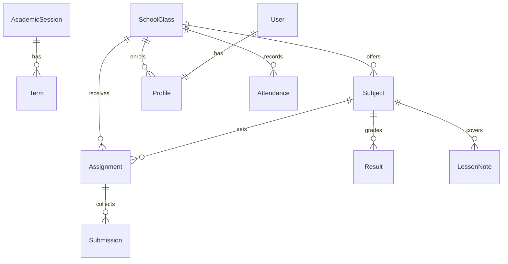

# School Management API

A class-centric school management backend for Nigerian primary and secondary schools. One teacher
manages one class of 10–50 students: they set work, enter results, write weekly lesson notes, post
announcements and take the daily register — and they decide exactly what students are allowed to see.

Django is a **headless JSON API**. The only server-rendered surfaces are the Django admin, where a
superuser creates teacher accounts and sets up sessions, terms and classes, and the print-optimised
HTML report card that the browser saves as a PDF.


The Angular SPA in `frontend/` is the school portal: students see their published results, lesson
notes, assignments and notices; teachers manage their class, enter and publish results, write notes
and take the register.

## The publishing rule

Every piece of content a teacher creates — `Result`, `LessonNote`, `Assignment`, `Announcement` — has a
status: **draft**, **published** or **archived**.

- A teacher sees everything they own, drafts included.
- A student only ever receives rows with `status = published` that belong to **their own class**.
- School-wide announcements (no class) reach every student, once published.
- Publishing is explicit: `PATCH` with `{"status": "published"}` or `POST /api/<resource>/{id}/publish/`.
  `published_at` is stamped automatically.

The filter is applied in the queryset, not the client, so a draft result cannot leak through a list
endpoint, a detail endpoint or a search parameter.

## Domain model



- **AcademicSession / Term** — e.g. `2025/2026`, `First Term`. One of each is current; the API exposes
  `GET /api/terms/current/`.
- **SchoolClass** — e.g. `JSS 2A`, with a class teacher and a capacity between 10 and 50.
- **Subject** — belongs to a class and is taught by a teacher.
- **Result** — `CA1` (10) + `CA2` (10) + `CA3` (20) + `Exam` (60) = `Total` (/100). Grade and remark are
  derived on save using the WAEC-style scale below.
- **LessonNote** — week number, topic, content and an optional attachment, per subject and term.
- **Announcement** — whole-school or one class.
- **Assignment / Submission / Attendance** — class work, uploads and the daily register.

### Grading (WAEC-style)

| Total | Grade | Remark |
| --- | --- | --- |
| 70–100 | A | Excellent |
| 60–69 | B | Very good |
| 50–59 | C | Good |
| 45–49 | D | Fair |
| 40–44 | E | Pass |
| 0–39 | F | Fail |

## Accounts

- **Teachers are created by a superuser in `/admin/`.** There is no public teacher registration.
- **Students are onboarded by their class teacher** from a CSV file:
  `POST /api/classes/{id}/import-students/` with columns
  `Full Name, Admission Number, Gender` (multipart `file`, or a JSON `students` array).
  The admission number becomes the username, the row gets the `DEFAULT_STUDENT_PASSWORD`, and
  `must_change_password` is set so the student must change it on first login.
- Students sign in with their admission number. The API never exposes a registration endpoint.

## Getting started

Requires Python 3.12+.

```bash
python -m venv .venv
source .venv/bin/activate          # Windows: .venv\Scripts\activate
pip install -r requirements.txt -r requirements-dev.txt

cp .env.example .env
python manage.py migrate
python manage.py seed_demo         # demo school: 1 class, 12 students, results, notes, register
python manage.py runserver
```

Then create a superuser for the admin with `python manage.py createsuperuser`.

### Running the SPA

```bash
cd frontend
npm install
npm start                          # ng serve on http://localhost:4200, proxying /api to :8000
```

The Django server must be running on `127.0.0.1:8000` (see `frontend/proxy.conf.json`). The build is
budgeted for low-bandwidth devices, and both portals are lazy-loaded route groups.

| Route | Who | What |
| --- | --- | --- |
| `/login` | everyone | Admission number (students) or username (teachers) |
| `/change-password` | forced on first login | Replaces the password the school issued |
| `/student/dashboard`, `/results`, `/notes`, `/assignments`, `/attendance`, `/announcements` | students | Published work, marks and their own register |
| `/teacher/dashboard`, `/class`, `/results`, `/broadsheet`, `/notes`, `/assignments`, `/submissions`, `/announcements`, `/attendance` | teachers | Roster and CSV import, score entry with publish, broadsheet and CSV import, notes, work, marking uploads, notices, register |

Seed credentials:

| Role | Username | Password |
| --- | --- | --- |
| Teacher (JSS 2A) | `teacher` | `teach-pass-1234` |
| Student | `JSS2A-001` | `Student@1234` |

## API

| Endpoint | Notes |
| --- | --- |
| `POST /api/token/`, `/api/token/refresh/` | JWT pair; username is the admission number for students |
| `GET /api/me/` | Role, class, admission number, `must_change_password` |
| `POST /api/me/password/` | Change password; clears the first-login flag |
| `GET /api/sessions/`, `/api/terms/`, `/api/terms/current/` | Academic calendar |
| `GET/POST /api/classes/` | Class list (teacher: own, student: theirs); create is admin-only |
| `POST /api/classes/{id}/import-students/` | CSV/JSON student onboarding, capacity-checked |
| `GET /api/classes/{id}/broadsheet/?session=&term=` | Students × subjects totals, averages, class averages and positions (published only) |
| `GET /api/classes/{id}/results/template/` | Blank CSV: `Admission Number, Subject, CA1, CA2, CA3, Exam` |
| `POST /api/classes/{id}/results/bulk-import/` | Upsert results from that CSV; new rows stay drafts, row-level errors reported |
| `GET /api/students/{id}/report-card/?session=&term=` | Print-ready HTML report card with positions, class averages and remark sections |
| `GET/POST /api/subjects/` | Subjects of the caller's class |
| `GET/POST /api/results/` | `?session=&term=&subject=&student=`; students see published only |
| `GET/POST /api/lesson-notes/` | Weekly notes with `?subject=&term=` |
| `GET/POST /api/announcements/` | School-wide or class notices |
| `GET/POST /api/assignments/` | `?class=&session=&term=` |
| `GET/POST /api/submissions/` | Students upload; teachers list their class |
| `PATCH /api/submissions/{id}/grade/` | Marks + feedback, cannot exceed the assignment total |
| `GET/POST /api/attendance/` | `?class=&date=` |
| `POST /api/attendance/bulk/` | Upsert a whole register for one date |
| `GET /api/attendance/summary/` | Present/late/absent totals per class |
| `POST /api/{results,lesson-notes,assignments,announcements}/{id}/publish/` | Publish to students |
| `POST .../archive/` | Withdraw from students without deleting |
| `GET /api/health/` | Readiness probe |
| `GET /api/schema/`, `/api/docs/` | OpenAPI schema and Swagger UI |

Authentication is JWT (`Authorization: Bearer <token>`). Teachers can only act on classes, subjects
and content they own; anything else returns `404` (not visible) or `403` (visible but not allowed).

## Tests and quality gates

```bash
pytest                                   # 79 tests
pytest --cov
ruff check . && ruff format --check .
mypy core academic_dashboard
python manage.py check --deploy
```

Coverage highlights: the grading scale and derived fields, the publish/draft visibility rule on all
four content types, cross-class isolation, admin-only class creation, CSV import (duplicates, bad
rows, capacity), admission-number login, the forced password change, attendance upserts and
summaries, and submission upload/grading limits.

## Docker

```bash
docker compose up --build
```

Daphne + PostgreSQL, migrations applied on start, API on <http://localhost:8000/>.

## Project layout

```
academic_dashboard/   settings (env-driven), ASGI/WSGI entry points, root URLs
core/
  models.py           sessions, classes, subjects, results, notes, assignments, attendance
  views.py            viewsets with the publishing and class-scoping rules
  serializers.py      API representations and validation
  permissions.py      teacher-only writes, staff-only setup
  admin.py            school-office control panel (teacher creation)
  management/commands/seed_demo.py
  migrations/         0017 (schema pivot), 0018 (legacy rows → school structure)
tests/                pytest suite (models, auth, content visibility, student onboarding)
frontend/             Angular SPA — student and teacher portals
```

## Design decisions

- **Visibility is a queryset concern.** Drafts are excluded at the database level for students, so no
  endpoint can accidentally return one.
- **Identity comes from the server.** Result and attendance rows take the student from the request or
  from the class roster; nothing trusts a client-supplied id for permission decisions.
- **The class is the security boundary.** Teacher scoping is expressed once per viewset as
  "class teacher or subject teacher"; objects outside it simply do not exist for that user.
- **Grading maths lives on the model.** `Result.compute()` and `Result.grade_for()` are unit-tested
  without touching HTTP.

## Not built yet

Nothing outstanding from the current scope.
